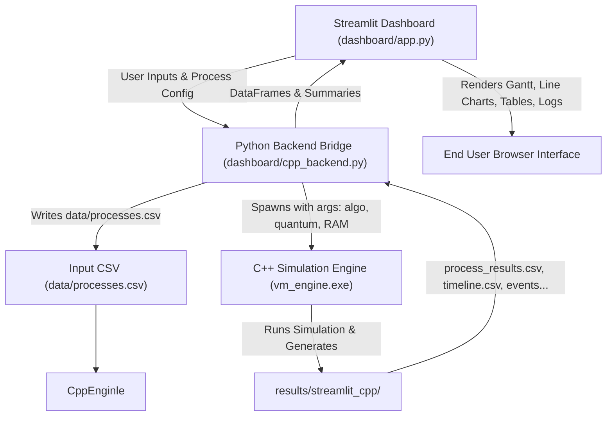

# OS Kernel & Virtual Machine Simulator

An interactive Operating System Kernel and Virtual Machine Hypervisor simulator featuring a high-performance **C++ simulation engine** (`vm_engine.exe`) coupled with an interactive **Streamlit telemetry dashboard** (`dashboard/app.py`).

The project simulates core OS kernel subsystems: process scheduling, process lifecycle state machines, hardware context / register simulation, memory management with admission control, and execution telemetry.

---

## 📖 Table of Contents
- [Operating System Concepts Simulated](#-operating-system-concepts-simulated)
- [Architecture & Workflow](#-architecture--workflow)
- [Project Directory Structure](#-project-directory-structure)
- [Supported Scheduling Algorithms](#-supported-scheduling-algorithms)
- [Outputs & Telemetry Generated](#-outputs--telemetry-generated)
- [Setup & Execution Guide](#-setup--execution-guide)
  - [Prerequisites](#prerequisites)
  - [Compiling the C++ Engine](#1-compiling-the-c-engine)
  - [Running the Streamlit Dashboard](#2-running-the-streamlit-dashboard)
  - [Running the Standalone C++ Simulator](#3-running-the-standalone-c-simulator)

---

## 🧠 Operating System Concepts Simulated

This simulator models fundamental Operating System concepts taught in computer science and operating systems courses:

### 1. Process Control Block (PCB)
Each process in the simulator maintains a comprehensive PCB structure (`struct Process`):
- **Identification:** Process ID (`PID`).
- **Timing & Demands:** Arrival Time, Burst Time, Remaining Time, Priority level.
- **Resource Footprint:** Memory requirement in MB.
- **State Information:** Current lifecycle state.
- **Hardware Context:** Program Counter (`PC`), General Purpose Registers (`R0`, `R1`, `R2`, `R3`).
- **Accounting & Performance:** Admission timestamp, Memory wait time, First dispatch/start time, Completion time, Turnaround time, Waiting time, Slice count, Context switch count.

### 2. Process Lifecycle & Extended State Transition Model
The simulation implements an extended 5-state process lifecycle:
```
 [New] ---> [Waiting for Memory] ---> [Ready] <---> [Running] ---> [Terminated]
```
- **`New`**: Process has been created/submitted.
- **`Waiting for Memory`** *(Admission Control / Suspended)*: Process has arrived at the system clock, but the available physical RAM is insufficient to satisfy its memory footprint. It waits until running processes release memory.
- **`Ready`**: The process has been allocated RAM and placed into the Ready Queue for CPU dispatch.
- **`Running`**: The process is actively executing on the simulated CPU for a quantum slice or full burst.
- **`Terminated`**: The process has completed its CPU burst time. Memory is deallocated back to the OS pool, and waiting processes are re-evaluated for admission.

### 3. CPU Scheduling & Preemption
The engine simulates CPU scheduling with accurate queue operations:
- **Non-Preemptive Scheduling:** The allocated process executes until completion or I/O.
- **Preemptive Scheduling (Round Robin):** The CPU allocates a fixed **Time Quantum ($q$)**. If the process does not complete within the quantum slice, it undergoes a context switch, returns to the `Ready` queue, and the next ready process is scheduled.
- **CPU Idle Detection:** When no processes are in the `Ready` queue, the CPU registers idle cycles until the next process arrives or is admitted.

### 4. Context Switching & Dispatching
- Simulates the overhead of switching CPU control between distinct processes.
- Records every context switch event with timestamp, previous PID, next PID, and state change.
- Calculates total context switches and idle vs. busy intervals.

### 5. Memory Management & Admission Control
- **Fixed Physical Memory Capacity:** The system operates under a configurable RAM limit (e.g., 1024 MB).
- **Long-Term Scheduler (Admission Control):** Prevents system over-subscription. A process cannot enter the Ready Queue without sufficient continuous/available RAM.
- **Dynamic Allocation & Reclaim:** Memory is claimed upon transition from `Waiting for Memory` $\to$ `Ready` and immediately released upon transition from `Running` $\to$ `Terminated`.

### 6. Simulated CPU Hardware Context & Registers
Virtual execution updates simulated hardware registers:
- **`PC` (Program Counter):** Increments linearly with elapsed execution duration.
- **`R0`:** Accumulated CPU execution time of the process.
- **`R1`:** Number of CPU bursts/slices granted.
- **`R2`:** Timestamp of the most recent slice completion.
- **`R3`:** Process PID verification register.

### 7. Performance Metrics & Telemetry
- **Turnaround Time ($TAT$):** $\text{Completion Time} - \text{Arrival Time}$
- **Waiting Time ($WT$):** $\text{Turnaround Time} - \text{Burst Time} - \text{Memory Wait Time}$
- **Memory Wait Time ($MWT$):** $\text{Admission Time} - \text{Arrival Time}$
- **CPU Utilization:** $\left(\frac{\text{Total Busy Time}}{\text{Total Elapsed Time}}\right) \times 100\%$

---

## 🏗️ Architecture & Workflow



1. **Dashboard Configuration:** The user enters processes (PID, Arrival, Burst, Priority, Memory) or selects presets in the web UI.
2. **Execution Invocation:** The Python bridge serializes the process table to `data/processes.csv` and invokes `vm_engine.exe` as a subprocess with chosen scheduling algorithm, quantum, and RAM parameters.
3. **Engine Simulation:** The C++ engine executes the event loop, applies admission control, schedules processes, updates virtual registers, and writes CSV event logs to `results/streamlit_cpp/`.
4. **Telemetry Visualization:** The dashboard parses the output files and renders interactive Gantt charts, memory utilization graphs, process state logs, and performance metrics.

---

## 📂 Project Directory Structure

```
Os_Virtual_Machine/
├── cpp/                           # C++ simulation source code
│   ├── main.cpp                   # Standalone CLI simulator entry point
│   ├── vm_engine.cpp              # Full-featured C++ engine (used by Dashboard)
│   ├── scheduler.cpp              # Standalone scheduling algorithm logic
│   ├── scheduler.h                # Header for standalone scheduler
│   ├── process.h                  # Process and ExecutionBlock data structures
│   └── memory_manager.cpp         # Memory manager module
├── dashboard/                     # Python Web UI & Bridge
│   ├── app.py                     # Main Streamlit dashboard application
│   ├── cpp_backend.py             # Subprocess wrapper connecting UI to vm_engine.exe
│   └── app_backup.py              # Backup of application code
├── data/                          # Input dataset directory
│   └── processes.csv              # Current active process input table
├── results/                       # Simulation output directory
│   └── streamlit_cpp/             # Engine-generated CSV reports & summary
│       ├── process_results.csv    # Final process metrics (TAT, WT, Registers, etc.)
│       ├── timeline.csv           # Gantt chart execution blocks
│       ├── memory_events.csv      # Memory allocation & deallocation trace
│       ├── state_events.csv       # Process lifecycle state transitions
│       ├── cpu_events.csv         # CPU slice & context switch events
│       └── summary.txt            # High-level engine summary (utilization, switches)
├── .streamlit/                    # Streamlit appearance & server configurations
│   └── config.toml                # Dark theme and telemetry UI configuration
├── vm_engine.exe                  # Compiled 64-bit C++ engine executable
├── simulator.exe                   # Compiled standalone CLI simulator executable
└── README.md                      # Project documentation
```

---

## ⚙️ Supported Scheduling Algorithms

| Algorithm | Type | Description |
| :--- | :--- | :--- |
| **FCFS** (First-Come, First-Served) | Non-Preemptive | Executes processes in strict arrival order (tie-broken by PID). |
| **SJF** (Shortest Job First) | Non-Preemptive | Selects the process with the shortest CPU burst time among ready processes. |
| **Priority** | Non-Preemptive | Selects the ready process with the highest priority (lower numeric value = higher priority). |
| **Round Robin (RR)** | Preemptive | Slices execution into fixed Time Quantum intervals ($q$), rotating through ready processes. |

---

## 📊 Outputs & Telemetry Generated

When a simulation completes, `vm_engine.exe` outputs 6 synchronized reports in `results/streamlit_cpp/`:

1. **`process_results.csv`**: Detailed final metrics per PID (Arrival, Burst, Memory, Admission, Start, Completion, Turnaround, Waiting, Memory Wait, PC, Registers R0–R3, Slices, Switches, State).
2. **`timeline.csv`**: Execution intervals (`Process`, `PID`, `Start`, `End`, `Duration`) used to build interactive Gantt charts.
3. **`memory_events.csv`**: Chronological log of RAM allocation, deallocation, and available memory capacity.
4. **`state_events.csv`**: State transition log recording every `New` $\to$ `Waiting for Memory` $\to$ `Ready` $\to$ `Running` $\to$ `Terminated` event.
5. **`cpu_events.csv`**: CPU execution slices, context switch pairs (`From PID` $\to$ `To PID`), PC tracking, and register dumps.
6. **`summary.txt`**: Overall simulation run stats (Algorithm, Total Context Switches, Busy Time, Total Elapsed Time, CPU Utilization %).

---

## 🚀 Setup & Execution Guide

### Prerequisites
- **Python 3.10+** (with `streamlit`, `pandas`, `plotly`)
- **C++ Compiler** (MSVC via Visual Studio / Build Tools or 64-bit MinGW/GCC supporting C++17)

### 1. Compiling the C++ Engine

#### Using MSVC (Recommended on Windows):
Open the **Developer Command Prompt for VS** or run via command line:
```cmd
cl /EHsc /O2 /std:c++17 cpp\vm_engine.cpp /Fe:vm_engine.exe
```

#### Using GCC / MinGW-w64:
```bash
g++ -O2 -std=c++17 cpp/vm_engine.cpp -o vm_engine.exe
```

### 2. Running the Streamlit Dashboard

Install Python dependencies (if not already installed):
```bash
pip install streamlit pandas plotly
```

Launch the dashboard:
```bash
python -m streamlit run dashboard/app.py
```

Access the UI at: **`http://localhost:8501`**

### 3. Running the Standalone C++ Simulator

You can also run the CLI simulation directly without the web dashboard:

#### Compiling the Standalone Simulator:
```cmd
cl /EHsc /O2 /std:c++17 cpp\main.cpp cpp\scheduler.cpp /Fe:simulator.exe
```

#### Running `simulator.exe`:
```cmd
.\simulator.exe
```

#### Running `vm_engine.exe` from CLI:
```cmd
.\vm_engine.exe data/processes.csv results/streamlit_cpp FCFS 2 1024
```
**Command Line Arguments:**
```
vm_engine.exe <input_csv> <output_dir> <algorithm> <quantum> <ram_mb>
```
- `<algorithm>`: `FCFS`, `SJF`, `Priority`, or `Round Robin`
- `<quantum>`: Time slice integer (for Round Robin)
- `<ram_mb>`: Total simulated RAM capacity in MB (e.g., `1024`)
